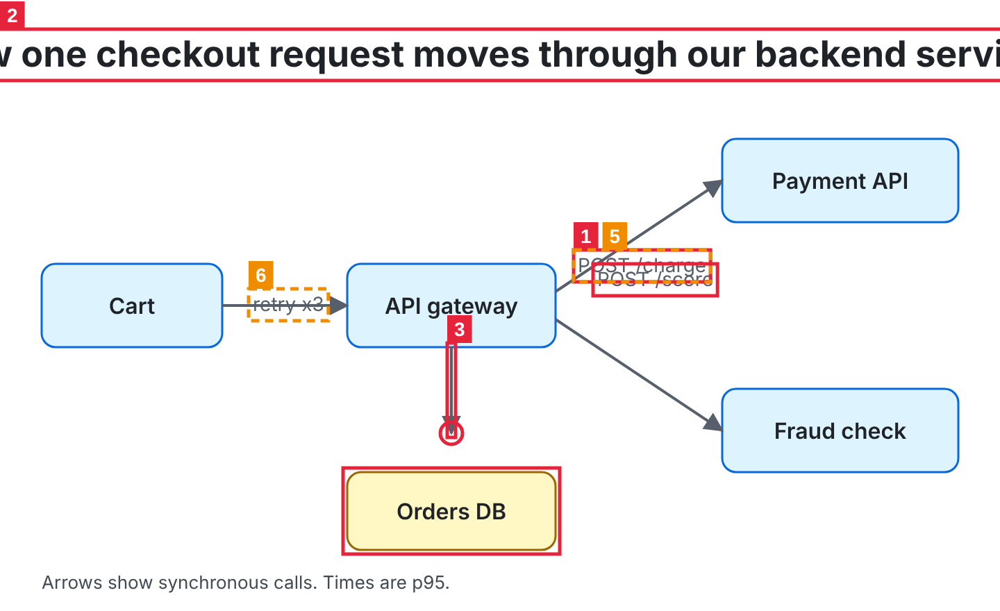
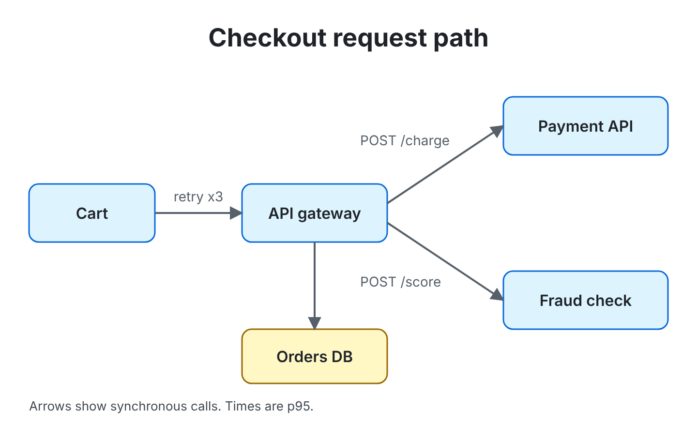

# figlint

[](https://ko-fi.com/jju1s)

Layout lint for HTML and SVG figures. figlint opens a diagram, chart or map in headless Chromium, measures what actually rendered, and tells you which labels overlap, which text is cut off, which arrows stop short of their box, and which text is unreadable in light or dark mode. It exits 1 when it finds errors, so a coding agent (or CI) can run it after drawing something and keep fixing until it passes.



```text
$ npx figlint broken.svg

  1. error  text-overlap  "POST /charge" overlaps "POST /score"
       fix  move "POST /score" 5px down (or "POST /charge" 5px up)

  2. error  text-clipped  "How one checkout request moves through …" is cut off by the SVG viewBox (49px past the left, 49px past the right)
       fix  the text is bigger than the SVG viewBox: shorten it, break it into two lines, or use a smaller font size

  3. error  dangling-connector  path ends in mid-air: end at (325, 312) is 28px from svg > rect.db:nth-of-type(6)
       fix  extend the end to (325, 340) in the path's coordinates, the edge of svg > rect.db:nth-of-type(6)

  4. error  low-contrast  "Arrows show synchronous calls. Times ar…" has contrast 2.11:1 on #0d1117 (needs 4.5:1) [dark only]
       fix  in the dark theme (prefers-color-scheme: dark), use #7b8087 for the text (now #424a53), or change the background

  5. warn   label-on-line  path runs through "POST /charge"
  6. warn   label-on-line  path runs through "retry x3"

4 errors, 2 warnings
```

After one round of fixes, following the `fix` lines:



The full report, with selectors and boxes, is in [docs/demo/report.txt](docs/demo/report.txt) and as JSON in [docs/demo/report.json](docs/demo/report.json). Both figures are in [docs/demo](docs/demo), and `node docs/demo/build.mjs` rebuilds every image there.

## Why

Agents now draw a lot of figures: architecture diagrams, charts, maps, slide graphics. When they check their work they look at a screenshot, and a screenshot hides exactly the small things that make a figure look broken: two labels overlapping by six pixels, an arrow that ends 20px before the box it points at, a title that runs a little past the edge, a caption that is fine on white and nearly invisible on a dark page. figlint measures those instead of eyeballing them, and gives coordinates the agent can apply.

## Install and run

```bash
npx figlint figure.svg
npx figlint page.html --json
npx figlint chart.svg --theme dark --shot marked.png
```

Or add it to a project with `npm install --save-dev figlint`. It needs Node 20 or newer and a Chromium. figlint uses the Chromium that Playwright installs (`npx playwright-core install chromium`), then any other Playwright Chromium on the machine, then an installed Chrome or Edge. Set `FIGLINT_CHROME=/path/to/chrome` to pick one yourself.

| option | |
|---|---|
| `--json` | print the report as JSON |
| `--theme light\|dark\|both` | color schemes to check (default both) |
| `--shot file.png` | save the render with each finding boxed and numbered (one file per theme) |
| `--width`, `--height` | viewport for HTML pages (default 1280x800; the height grows to fit the page). SVG files use their own size |
| `--wait ms` | extra time after load, for figures drawn by scripts (default 250) |
| `--timeout ms` | load timeout (default 15000) |
| `--tolerance px` | how close a line end has to be to a shape to count as attached (default 4) |
| `--only`, `--skip` | comma-separated rule names |
| `--strict` | exit 1 on warnings too |
| `--scale n` | device pixel ratio for `--shot` |

Exit codes: 0 when there are no errors, 1 when there are errors (or warnings with `--strict`), 2 when figlint itself could not run.

Several files can be checked in one call. Inputs can also be URLs, so `figlint http://localhost:5173/diagram` works against a dev server.

## What it checks

| rule | severity | what fires it |
|---|---|---|
| `text-overlap` | error | two pieces of text overlap by more than 1px after trimming the empty space above and below the glyphs |
| `text-covered` | error | a filled shape or box is painted on top of at least a quarter of a label |
| `text-clipped` | error | text runs past the SVG viewBox, the page, or an ancestor with `overflow` other than visible |
| `off-canvas` | error / warning | a shape is entirely outside its SVG (error) or sticks out by 2px or more (warning) |
| `dangling-connector` | error | an arrow or connecting line has an end that touches no shape, text or other line |
| `text-shape-overlap` | warning | a label is between 10% and 90% inside a filled rect, circle, ellipse, polygon or HTML box |
| `label-on-line` | warning | a visible stroke runs through a label that has no halo or opaque background |
| `low-contrast` | error / warning | text below WCAG AA (4.5:1, or 3:1 for text 24px and up or 18.66px bold). Under 3:1 is an error |

Every finding comes with a CSS selector, the element's box in page pixels, the other element involved (when there is one) and a `fix` line. Distances in the fix are in the element's own units, so an agent can apply them to the SVG source directly.

### How it avoids false alarms

Most of the work in figlint is in not reporting things that are fine. These are the rules it follows, so you can predict what it will say:

- **Text boxes are trimmed.** A text box includes room for accents and descenders. figlint trims about 20% of the font size off the top and 14% off the bottom before testing overlaps, so lines of a paragraph or stacked `tspan`s with tight leading don't count.
- **Text fully inside a shape is a badge, not a collision.** White text on a blue pill, a number in a circle, a label in its node box: all fine. Only a label hanging over the edge of a shape is reported, and only for rects, circles, ellipses, polygons and HTML boxes. Paths are left out because on maps labels cross region borders all the time.
- **What is on top matters.** `text-covered` and `label-on-line` use the browser's own hit testing (`elementsFromPoint`) to see what is painted above what. A line that passes under a label's opaque chip, or under a label with a halo (`stroke` plus `paint-order: stroke`), is hidden and not reported.
- **What counts as a connector.** A line or open path with `marker-start` or `marker-end`, or with a class or id containing edge, link, arrow, connector, wire, flow or leader (on itself or its parent group), must have both ends attached. A plain line counts as a connector only if one end already sits on a shape; then the other end must land somewhere too. That keeps axes, gridlines, ticks and legend swatches out. Dashed lines, very long paths (more than 60 commands, usually map borders or data lines), and lines that arrows end on (sequence-diagram lifelines, buses) are never treated as plain connectors.
- **"Attached" means within 4px** of a shape's fill or stroke, plus half the line's stroke width, plus the size of its arrowhead marker. Lines may also end on text or on other lines. Shapes covering 40% or more of the canvas, such as backgrounds, don't count as targets.
- **Cropping is allowed.** Backgrounds that bleed past every edge, anything inside a `clip-path` or `mask`, groups with 25 or more siblings of the same kind (map countries, scatter dots), and paths that are only partly outside are not reported as off-canvas.
- **Contrast is measured on the real background.** figlint hides the text, takes a screenshot, and uses the most common color under each label as its background. A halo counts as the background when there is one. Transparent SVGs are checked on white in light mode and on `#0d1117` (GitHub's dark page) in dark mode, because that is where they usually end up. Dark mode is `prefers-color-scheme: dark`; a figure that ignores it is checked as it renders.

### Escape hatches

Add `data-figlint-ignore` to an element or a group to skip it for every rule, or give it a list to skip only some:

```html
<text data-figlint-ignore="low-contrast">DRAFT</text>
<g data-figlint-ignore="label-on-line text-shape-overlap"> ... </g>
```

Add `data-figlint-connector` to a plain line to have both of its ends checked like an arrow.

## For agents: the skill

[skills/figlint/SKILL.md](skills/figlint/SKILL.md) tells Claude Code, Codex and other agents to run figlint after drawing any HTML or SVG figure, read the findings, fix them, and run it again until it exits 0. It also explains each rule and when an ignore is acceptable.

```bash
git clone https://github.com/cig13zs/figlint
cp -r figlint/skills/figlint ~/.claude/skills/     # Claude Code
cp -r figlint/skills/figlint ~/.codex/skills/      # Codex
```

The skill calls `npx -y figlint`, so nothing else needs installing besides a browser.

## JSON output

`--json` prints one object per file (an array when several files are given):

```json
{
  "figlint": "0.1.0",
  "file": "broken.svg",
  "themes": ["light", "dark"],
  "viewport": { "width": 720, "height": 440 },
  "document": "svg",
  "ok": false,
  "errors": 4,
  "warnings": 2,
  "findings": [
    {
      "rule": "dangling-connector",
      "severity": "error",
      "themes": ["light", "dark"],
      "message": "path ends in mid-air: end at (325, 312) is 28px from svg > rect.db:nth-of-type(6)",
      "selector": "svg > path.edge:nth-of-type(4)",
      "box": { "x": 325, "y": 250, "width": 0, "height": 62 },
      "related": [
        { "selector": "svg > rect.db:nth-of-type(6)", "box": { "x": 250, "y": 340, "width": 150, "height": 56 } }
      ],
      "hint": "extend the end to (325, 340) in the path's coordinates, the edge of svg > rect.db:nth-of-type(6)",
      "data": {
        "ends": [
          {
            "which": "end",
            "at": { "x": 325, "y": 312 },
            "nearest": {
              "selector": "svg > rect.db:nth-of-type(6)",
              "distance": 28,
              "point": { "x": 325, "y": 340 },
              "local": { "x": 325, "y": 340 }
            }
          }
        ],
        "explicit": true
      }
    }
  ],
  "notes": [],
  "shots": [],
  "stats": { "texts": 10, "shapes": 10, "boxes": 0 }
}
```

| field | |
|---|---|
| `ok` | `true` when there are no errors |
| `themes` (top level) | the color schemes that were checked |
| `findings[].themes` | the schemes the finding showed up in; a finding found in both is listed once |
| `findings[].selector` | a CSS selector for the element (an `#id` when the element or an ancestor has a unique one) |
| `findings[].text` | the label's text, shortened to 40 characters, for text findings |
| `findings[].box`, `related[].box` | bounding boxes in CSS pixels from the top-left of the page |
| `findings[].hint` | the suggested fix, as one sentence |
| `findings[].data` | rule-specific numbers: `overlap` box for `text-overlap`; `outside` per side for `text-clipped`; `outsideFraction` and `overflow` for `off-canvas`; `ends` (with `local` coordinates in the line's own units) for `dangling-connector`; `insideFraction` for `text-shape-overlap`; `ratio`, `required`, `foreground`, `background`, `fontSize` and `suggestion` for `low-contrast` |
| `notes` | things worth knowing, such as a page that timed out while loading |

## From code

```js
import { lint } from 'figlint';

const report = await lint('diagram.svg', { themes: ['light', 'dark'] });
if (!report.ok) console.log(report.findings);
```

`lint(file, options)` takes the same options as the CLI (`themes`, `width`, `height`, `wait`, `timeout`, `tolerance`, `only`, `skip`, `shot`, `scale`, `chrome`), plus `browser` to reuse a Playwright browser across many files and `beforeLoad(page)` to set up routes or cookies before the page loads.

## Tried on real figures

**map-design.** I ran figlint on the six example maps in [map-design](https://github.com/cig13zs/map-design), in both of its themes (12 runs). The first version was noisy, and that shaped most of the rules above. Per theme it reported 125 `off-canvas` errors for countries outside the two regional crops, 33 `text-shape-overlap` warnings for city labels crossing country borders, 5 `label-on-line` warnings for graticule lines that the SVG had clipped away and nobody could see, and 5 contrast errors on one dark map where each label mixed two fills across `tspan`s and figlint read the wrong one. All of those were false positives, and all are gone now.

What it reports on those maps now:

- No overlap, clipping, off-canvas or dangling-arrow findings. The maps had already been fixed by hand for the collisions map-design's own review found, so this is the expected result rather than proof of anything.
- The source line under each map is `#8a8378` on `#fbf8f1`: 3.54:1 in light mode and 3.93:1 in dark. A real WCAG AA miss, reported as a warning on all six maps.
- Region and sea labels (GOBI, TAKLAMAKAN, BORNEO, SOUTH CHINA SEA) are between 1.8:1 and 2.1:1 in light mode. They fail WCAG, and figlint reports them as errors. They are also faint on purpose, as map-design's style guide asks for. That is a style call figlint can't make; `data-figlint-ignore="low-contrast"` on those labels is the honest fix if you keep them.
- One `label-on-line` warning: a country border runs through "IRANIAN PLATEAU". True, and the same deliberate style choice (region labels have no halo).

**Figures drawn for this repo.** [examples/](examples) has three figures written the way an agent would write them. Two had real mistakes figlint caught on the first run, both fixed in the follow-up commit: the bar chart's "1,900" value label sat on a gridline, and the release-flow arrow started 12px below the Canary box because the box was shorter than I assumed. The sequence diagram first drew three errors for its lifelines (dashed lines from each actor down to nothing), which were false positives and led to the lifeline rule. It still gets two warnings, for message labels crossing the middle lifeline. They are real crossings; whether they bother you is a matter of taste.

## Limits

- Checks are geometric. figlint doesn't know what a figure is supposed to say, so it can't tell you an arrow points at the wrong box, only that it points at nothing.
- Shape tests use bounding boxes for HTML elements, `<use>` and `<image>`, so a label next to a rotated or round HTML element can be misjudged.
- Contrast is measured against the most common background color under the text. Text over gradients, photos or busy patterns gets one number that may not tell the whole story. Gradient-filled text is skipped.
- On maps, almost anything touches a border mesh, so a leader line that ends near a border counts as attached. Dangling checks are most useful on diagrams.
- `canvas` and WebGL drawings are opaque pixels to figlint; only DOM text and SVG shapes are checked.
- Charts that keep animating can be measured mid-animation. Use `--wait` or turn animation off for the check.
- Fonts that fail to load are replaced by fallbacks, and the fallback's metrics are what gets measured.
- It is tested on Chromium only, and on Node 22 and 24 in CI.

## License

MIT
